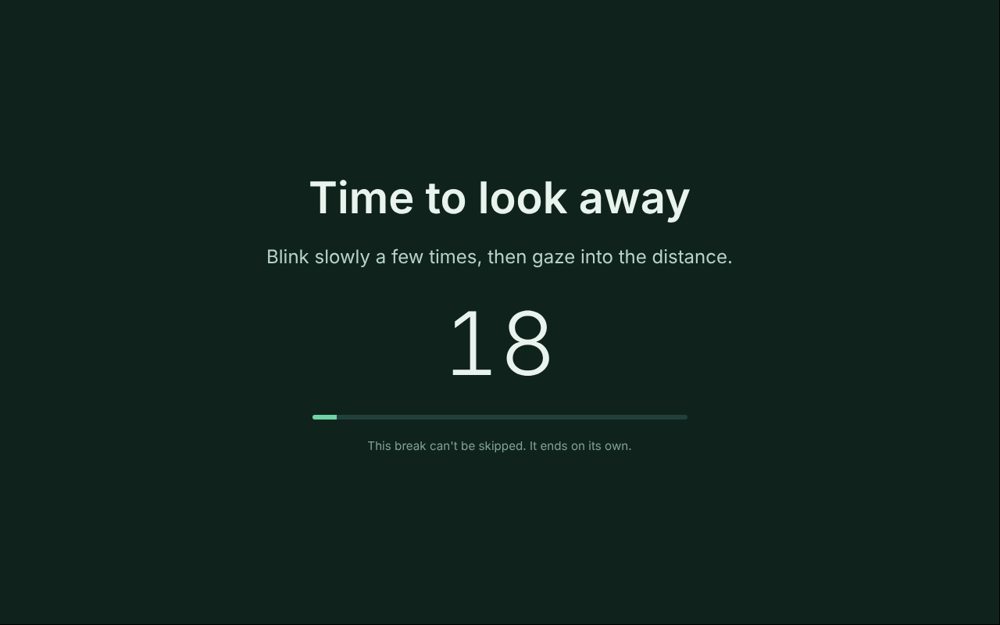

# Go Away

A break app in the spirit of [Stretchly](https://github.com/hovancik/stretchly), with two differences:

1. **It knows your schedule.** A break never starts in the middle of a meeting, a Slack huddle or a call. It waits, and starts the moment you're free.
2. **It doesn't negotiate.** Once a break starts, it covers every screen and runs to the end. There is no skip or snooze button, and no MCP tool or settings change can get you out of one.

You set it up mostly by talking to your AI assistant through its MCP server.



## How it decides when to break

| Default | Why |
| --- | --- |
| 20 s eye break every 20 min | 20-20-20 rule |
| 5 min movement break every 60 min | NIOSH supplementary-break studies |
| Wait for meetings, huddles and calls to end | Interruptions mid-task cost more than at a breakpoint |

Sources and the full reasoning: [docs/SCIENCE.md](docs/SCIENCE.md).

"Busy" means any of:

- **A meeting in your calendar**: an event with other attendees or a video-call link, not marked "free", not declined by you. Solo blocks (e.g. "Lunch") don't count unless you set `calendar.soloEventsAreMeetings`.
- **A Slack huddle**: read from your Slack profile's huddle state (needs a user token with `users.profile:read`).
- **Your microphone is in use** (Linux: PulseAudio/PipeWire, Windows: the privacy consent store). On macOS there's no CLI for this, so Go Away checks for a Zoom meeting process and relies on Slack and the calendar; you can add your own check with `presence.inCallCommand`.
- **A meeting starts before the break would end.**

Other rules:

- **Focus sessions.** Calendar events with "Focus", "Deep work" or 🎯 in the title (configurable), or sessions you start from the tray or MCP. Eye breaks still happen; the long break waits for the session to end, for at most 90 minutes past due.
- **Pull forward.** If a long break is almost due and a meeting is about to start, the break starts early so it ends right before the meeting.
- **Away counts.** 5+ minutes idle, asleep or locked (and not on a call) counts as a long break.
- **No escape hatches.** Quitting is disabled during a break; if the app is killed, the break comes back on restart until its original end time. Settings that make breaks rarer, shorter or disabled only apply after the next completed break.

## Run it

```sh
npm install
npm start          # builds and launches the tray app
```

Requires Node 22+. Settings live in `~/.go-away/config.json` (override with `GO_AWAY_HOME`).

## Connect your calendar

Google Calendar → Settings → your calendar → *Integrate calendar* → copy **Secret address in iCal format**, then tell your assistant "add this calendar to Go Away: <url>" (or put it in `calendar.icsUrls`). Add your calendar email to `calendar.ownerEmails` so meetings you declined are ignored.

To plan focus time, create calendar events with a focus keyword in the title, for example by asking your assistant to "block 9–11 tomorrow as 🎯 Focus" through its calendar connector. Go Away picks them up on the next refresh (every 5 minutes).

## MCP server

The tray menu has **Copy MCP server config**. It produces:

```json
{
  "mcpServers": {
    "go-away": { "command": "node", "args": ["/path/to/go-away/dist/mcp/server.js"] }
  }
}
```

For Claude Code: `claude mcp add go-away -- node /path/to/go-away/dist/mcp/server.js`.

| Tool | What it does |
| --- | --- |
| `get_status` | Working / on break / waiting for a meeting / holding for focus; next breaks; live call signals |
| `get_config`, `update_config` | Read or patch any setting |
| `add_calendar`, `remove_calendar` | Manage iCal feeds |
| `get_schedule` | Meetings and focus sessions Go Away sees |
| `start_focus_session`, `end_focus_session` | Start now or schedule one (`startAt`) |
| `set_slack_token` | Enable huddle detection |
| `get_break_history` | Breaks taken and how long they waited |
| `explain_break_science` | The research behind the defaults |
| `skip_break` | Always refuses, and says why |

The MCP server talks to the running app over a localhost-only API whose port and random token are in `~/.go-away/control.json` (mode 0600).

## Develop

```sh
npm test           # typecheck + unit and MCP end-to-end tests
```

Layout: `src/core` holds the scheduler, calendar, presence detection, engine and control API (plain Node, fully tested); `src/main` is the Electron shell (tray, break windows); `src/mcp` is the stdio MCP server; `src/renderer` is the break screen.

## Not done yet

- Packaged installers (electron-builder) and auto-start on login for unpackaged builds.
- Native "mic in use" detection on macOS.
- Writing focus sessions back to Google Calendar (today: create them with your assistant's calendar connector).
- Google Calendar OAuth (today: the secret iCal address, which is read-only and needs no Google Cloud project).
